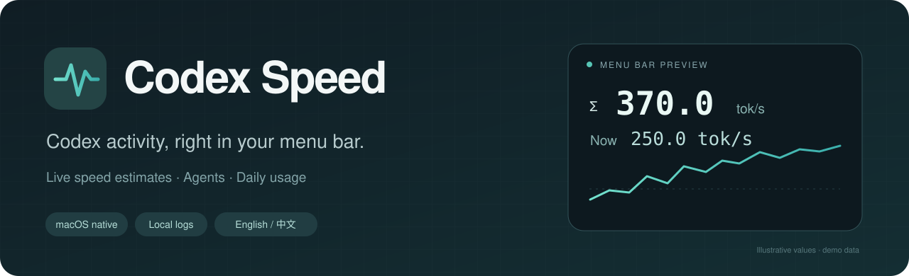
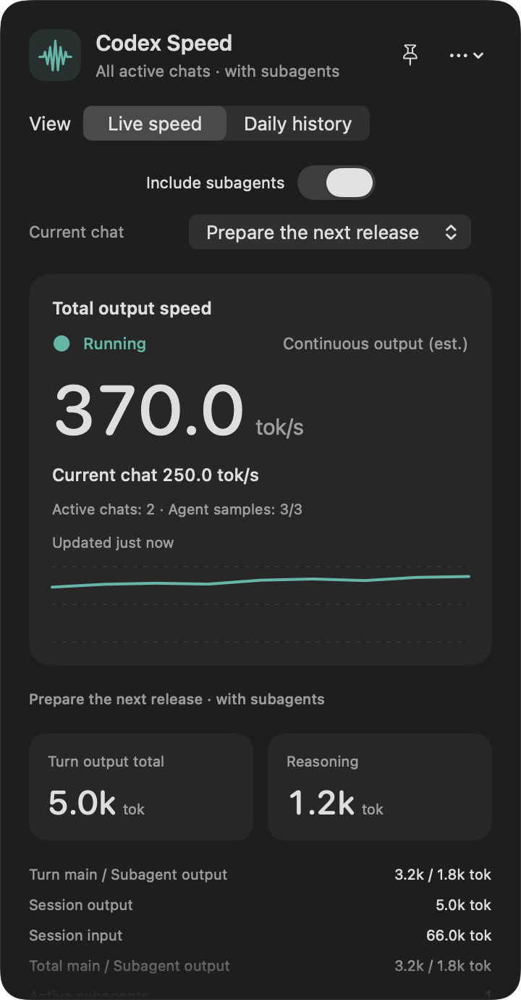
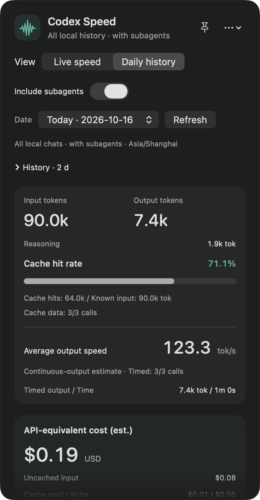

<p align="center">
  
</p>

<p align="center">
  <a href="https://github.com/linzcB/Codex-Speed/releases"><strong>Download for Mac</strong></a> ·
  <a href="README.zh-CN.md">简体中文</a> ·
  <a href="docs/STATISTICS.md">How measurements work</a> ·
  <a href="CHANGELOG.md">Changelog</a>
</p>

<p align="center">
  <a href="https://github.com/linzcB/Codex-Speed/actions/workflows/ci.yml"></a>
  
</p>

**A native macOS menu bar app for Codex speed and usage.** See which chats and agents are active, inspect daily token totals, and estimate API-equivalent costs from local logs. No API key is required.

## A small view into a busy session

<table>
  <tr><th>Live speed</th><th>Daily history</th></tr>
  <tr>
    <td align="center"></td>
    <td align="center"></td>
  </tr>
</table>

<p align="center"><sub>Actual app interface with generated demo data. No real chats or account usage are shown.</sub></p>

| What you can see | What it tells you |
| --- | --- |
| **Two menu bar rows** | The top row sums active chats; the bottom follows your selected chat. |
| **Output speed and latency** | Continuous-output estimates, a tool-excluded average, whole-turn speed, and first-text / first-token latency when recorded. |
| **Subagent activity** | Count active subagents, inspect their individual speeds, and choose whether they contribute to totals. |
| **Daily history** | Input, output, reasoning, cache hit rates, models, and time-weighted output speed, including archived local chats. |
| **API cost estimates** | Standard/Fast estimates with pricing coverage and unknown modes shown explicitly. |
| **A native workflow** | A pinnable floating sidebar, CSV export, custom log folders, and instant English / 简体中文 switching. |

## Install

1. Open [Releases](https://github.com/linzcB/Codex-Speed/releases) and download `Codex-Speed-<version>.zip` from **Assets**.
2. Unzip it and move **Codex Speed.app** to **Applications**.
3. Open the app. Its two-line readout appears in the menu bar; click it for details.

One universal app supports **Apple Silicon and Intel, on macOS 13 or later**. GitHub's automatically generated **Source code** archives are for building the app yourself.

Release builds are ad hoc signed and are **not notarized by Apple**. If macOS blocks opening, see [Apple's guidance](https://support.apple.com/guide/mac-help/mh40616/mac) before deciding whether to allow the app. Checksums are included with releases.

## Make it yours

- **Choose a chat:** use **Current chat** in the panel. **Most recent (automatic)** follows log activity; it does not detect which chat is selected inside Codex.
- **Pin the panel:** click the pin button to keep a floating sidebar open.
- **Include agents:** toggle **Include subagents**. Both menu bar rows, token totals, and daily history use this choice.
- **Change language:** open **… → Language → Follow system / 简体中文 / English**. The choice takes effect immediately and is remembered.
- **Choose logs or export:** both options are in the **…** menu. Logs default to `~/.codex/sessions`, or `sessions` under `CODEX_HOME`.

## Understand the numbers

Speed is an **estimate from log timestamps**. Continuous-output mode excludes recorded pre-output waits and tools between output segments, and includes reasoning and generated tool arguments. It does not measure each token as it is decoded.

Parallel agents are timed separately. Their live speeds are added; daily average speed uses total timed output divided by total output time. Cost estimates use supported prices and logged Standard/Fast settings; they are **not subscription charges or confirmed API bills**. Cloud-only chats are absent when their logs are unavailable locally.

Read [measurement definitions](docs/STATISTICS.md) or the [FAQ](docs/FAQ.md) for details.

## Privacy

The app reads local logs and builds statistics in memory. It does not upload logs, read authentication credentials, or save extra copies of chat content. Preferences and the selected log-folder path are saved locally. Opening an official pricing link opens your browser; it does not send your logs.

## Build from source

Use Xcode Command Line Tools with **Swift 5.9 or later**:

```sh
git clone https://github.com/linzcB/Codex-Speed.git
cd Codex-Speed
./build.sh
open "dist/Codex Speed.app"
```

Run `swift test` for the test suite. To build a distributable app and checksum file, run `./scripts/package-release.sh`.

## Contribute

Bug reports, translations, and improvements are welcome. Start with [CONTRIBUTING.md](CONTRIBUTING.md), [report a bug](https://github.com/linzcB/Codex-Speed/issues/new?template=bug_report.yml), or [suggest a feature](https://github.com/linzcB/Codex-Speed/issues/new?template=feature_request.yml). Please use generated examples instead of attaching raw conversation logs.

An unofficial companion utility for Codex.

## License

Released under the [MIT License](LICENSE). Copyright © 2026 linzcB.
