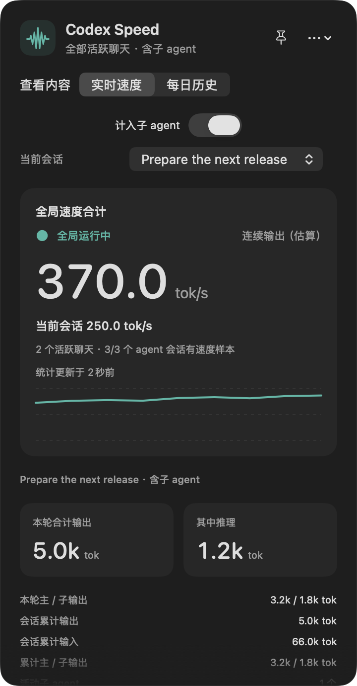
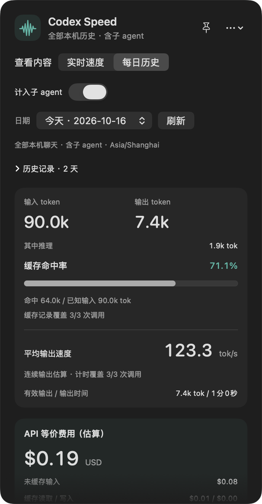

<p align="center">
  
</p>

<p align="center">
  <a href="https://github.com/linzcB/Codex-Speed/releases"><strong>下载 macOS 安装包</strong></a> ·
  <a href="README.md">English</a> ·
  <a href="docs/STATISTICS.zh-CN.md">统计口径</a> ·
  <a href="CHANGELOG.md">更新记录</a>
</p>

<p align="center">
  <a href="https://github.com/linzcB/Codex-Speed/actions/workflows/ci.yml"></a>
  
</p>

**一个原生 macOS 菜单栏工具，用来查看 Codex 的速度与用量。** 从本机日志了解活动会话、子 agent、每日 token 和 API 等价费用，无需 API Key。

## 在菜单栏里，看清正在发生什么

<table>
  <tr><th>实时速度</th><th>每日历史</th></tr>
  <tr>
    <td align="center"></td>
    <td align="center"></td>
  </tr>
</table>

<p align="center"><sub>真实应用界面，使用自动生成的演示数据；不包含真实会话或账号用量。</sub></p>

| 功能 | 可以查看什么 |
| --- | --- |
| **菜单栏两行速度** | 上行汇总全部活动聊天，下行展示所选会话。 |
| **输出速度与延迟** | 连续输出估算、扣除工具后的均速、整轮均速，以及有记录时的首字和首 token 延迟。 |
| **子 agent 明细** | 活动数量、每个 agent 的独立速度，以及是否计入合计的开关。 |
| **每日历史** | 输入、输出、推理、缓存命中、使用模型和加权平均速度，覆盖本地已归档聊天。 |
| **预计每小时费用** | 按最近 1、5、15 分钟花费推算全局和当前会话的 USD/h，显示可计价调用覆盖率。 |
| **API 等价费用** | 按日志中的 Standard / Fast 设置估价，标注覆盖率及未知模式。 |
| **原生交互** | 固定悬浮侧栏、CSV 导出、自定义日志位置，以及即时中英文切换。 |

## 安装

1. 打开 [Releases](https://github.com/linzcB/Codex-Speed/releases)，从 **Assets** 下载 `Codex-Speed-<版本号>.zip`。
2. 解压，将 **Codex Speed.app** 拖入“应用程序”。
3. 打开应用，顶部菜单栏会出现两行读数；点击即可查看详情。

同一安装包支持 **Apple Silicon 与 Intel，要求 macOS 13 或更新版本**。GitHub 自动生成的 **Source code** 压缩包供自行编译使用。

当前构建使用临时签名，**尚未经过 Apple 公证**。如果 macOS 阻止打开，请先阅读 [Apple 官方说明](https://support.apple.com/guide/mac-help/mh40616/mac)，再决定是否允许运行。发布附件中包含校验文件。

## 常用操作

- **选择会话：** 在“当前会话”中选择；“最近活动（自动）”跟随日志活动，不能识别 Codex 窗口当前选中的聊天。
- **固定侧栏：** 点击图钉，将详情固定为悬浮窗口。
- **统计子 agent：** “计入子 agent”同时控制两行速度、token 合计和每日历史。
- **排除自动审核：** “计入 Codex auto review”默认关闭，两行实时速度、活动数、会话合计、每日历史和 CSV 导出都会排除它。实时与历史页面共用同一开关；明细保留原始记录，可随时重新计入。
- **切换语言：** 打开 **…**，直接点击 **跟随系统 / 简体中文 / English**，立即生效并记住选择。
- **选择日志或导出：** 均在“…”菜单中。默认读取 `~/.codex/sessions`，或 `CODEX_HOME` 下的 `sessions`。

## 如何理解这些数字

速度根据**日志时间戳估算**，并非逐 token 的即时解码速度。连续输出模式排除已记录的输出前等待和段间工具执行，包含推理与生成的工具参数。

并行 agent 分别计时，实时速度相加；每日均速则是有效输出 token 总量除以对应输出时间总和。费用按已支持的价格和日志设置估算，**不等于订阅扣款或已确认的 API 账单**。没有同步到本机日志的云端会话无法统计。

详见[统计口径](docs/STATISTICS.zh-CN.md)和[常见问题](docs/FAQ.zh-CN.md)。

## 隐私

应用在本机读取日志，统计保存在内存中，不上传日志、不读取认证凭据，也不额外保存聊天正文。只持久保存显示偏好和所选日志目录。点击官方价格链接会打开浏览器，不会发送你的日志。

## 自行编译

需要 Xcode Command Line Tools 和 **Swift 5.9 或更新版本**：

```sh
git clone https://github.com/linzcB/Codex-Speed.git
cd Codex-Speed
./build.sh
open "dist/Codex Speed.app"
```

运行 `swift test` 执行测试；运行 `./scripts/benchmark.sh` 可用模拟数据做性能测试，详见[性能说明](docs/PERFORMANCE.md)。运行 `./scripts/package-release.sh` 可生成安装包及校验文件。

## 参与贡献

欢迎反馈问题、改进翻译或提交代码。请先阅读 [CONTRIBUTING.md](CONTRIBUTING.md)，也可以[报告问题](https://github.com/linzcB/Codex-Speed/issues/new?template=bug_report.yml)或[提出建议](https://github.com/linzcB/Codex-Speed/issues/new?template=feature_request.yml)。反馈时请使用模拟示例，避免直接上传真实聊天日志。

这是为 Codex 开发的非官方辅助工具。更早版本的详细说明保留在 [README.txt](README.txt)。

## 许可证

采用 [MIT 许可证](LICENSE)。Copyright © 2026 linzcB。
